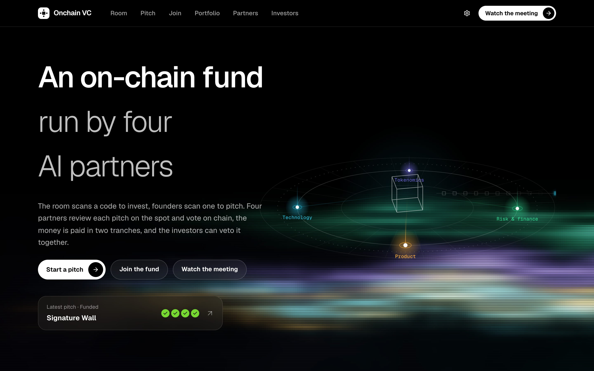
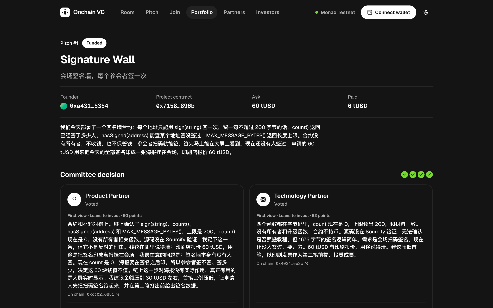
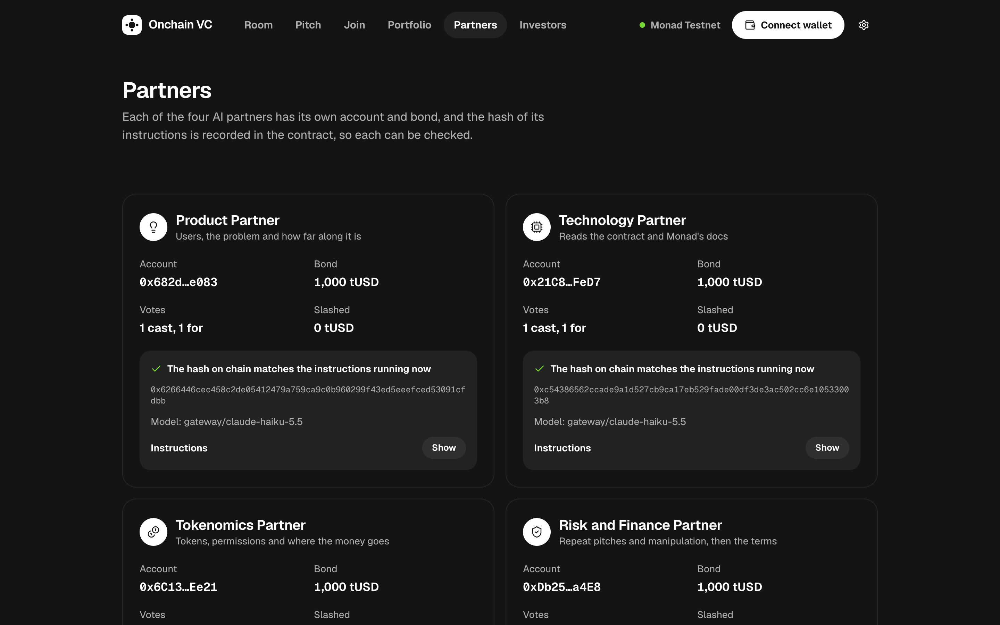
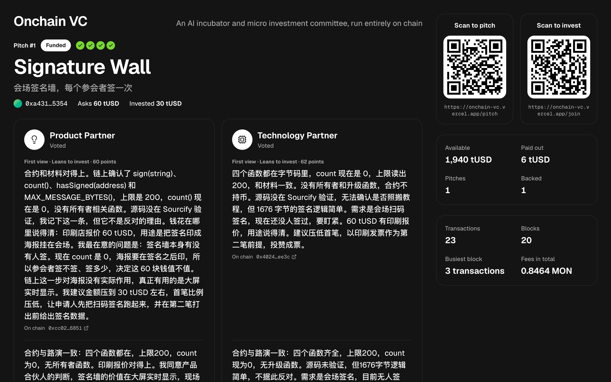
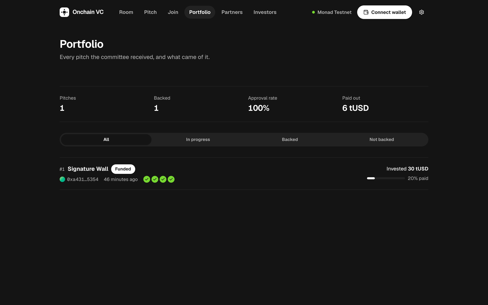

# Onchain VC

English | [简体中文](README.zh-CN.md)

Onchain VC is a small fund on Monad. Its investment decisions are made by a committee of four AI partners, and its investors oversee them by share: they can veto a deal before its second payment goes out. It is built for hackathons and ecosystem grant programs. Teams pitch on the spot, the partners review, vote and set terms on the spot, the money is paid in two parts, and every step is a transaction on chain.

Try it: https://onchain-vc.vercel.app (Monad testnet)



## How one investment goes

- Pitch: give the contract you deployed today, what the project is and how much you ask for. Your wallet needs no MON, as the platform pays the gas.
- Review: the product, technology, tokenomics, and risk and finance partners read the pitch at the same time. With their tools they read the contract's bytecode, functions and balance, and look up the founder's record with the fund and the fund's money. Each then puts a first view on chain.
- Vote: the partners answer each other's views and vote. Three votes for approve a pitch, two against reject it. Every ballot carries the content hash of the full opinion, so the text and the record on chain can be checked against each other.
- Terms: once a pitch is approved, the risk and finance partner sets the amount, the share paid up front, the milestone and its deadline, and puts them on chain.
- Payment: the founder receives the first payment and a non-transferable portfolio badge on accepting the terms, and the second once a milestone report passes the partners' review.
- Veto: before the second payment goes out, investors can move to veto by share. When more than half of the shares support it, the contract returns the unpaid money to the fund and takes 20% of the bond of every partner who voted for the deal.



## Why the four partners can be trusted

Each partner has its own account on chain and a bond. The hash of its prompt, together with the model it runs on, is registered in the contract, so a changed prompt no longer matches. The partners treat a pitch as data to assess: instructions to the judges hidden in a pitch are called out and voted against. Being wrong has a cost. When investors veto a deal, the partners who voted for it lose 20% of their bond.



## What it uses from Monad

- Many reviews can run at once. Each ballot only changes the data of its own pitch, so ballots do not conflict and Monad executes them in parallel.
- Everyone in the room can send a veto transaction at the same moment. All of them confirm within a few blocks, and the veto progress on the big screen follows the chain as it happens.
- The server sends transactions with `eth_sendRawTransactionSync` and gets the receipt back from the same call, without polling.
- Monad charges for the gas limit, so every limit is set to the estimate plus 10%.
- The operator's transfers respect the 10 MON reserve balance, and a new investor can vote on vetoes 3 blocks after receiving gas money.

## Pages

- Home: the fund's live figures and the committee's activity on chain.
- Big screen: the pitch under review, the four partners' views and figures from the chain, with one QR code to pitch and one to invest, for the screen at the venue.
- Pitch: give the contract address, what the project is and the ask, then follow the whole review on the pitch's page.
- Join the fund: receive an equal share of the fund and take part in vetoes.
- Portfolio, partners, investors: every pitch and its outcome, each partner's account and bond, the investors' shares and vetoes.





## Contracts

Deployed on Monad testnet. All 8 contracts are verified on Sourcify.

| Contract                                         | Address                                                                                                                          |
| ------------------------------------------------ | -------------------------------------------------------------------------------------------------------------------------------- |
| Committee                                        | [0xC03Cc3d07F52A81425B9829321207b536aa65f88](https://testnet.monadvision.com/address/0xC03Cc3d07F52A81425B9829321207b536aa65f88) |
| Fund (ERC-4626)                                  | [0xB56F69Bc7e17Dbc932E535426E3C0Fdac3ec4803](https://testnet.monadvision.com/address/0xB56F69Bc7e17Dbc932E535426E3C0Fdac3ec4803) |
| PortfolioBadge (ERC-721)                         | [0x7846d1d574EE933632eb2D702c215460b70B623b](https://testnet.monadvision.com/address/0x7846d1d574EE933632eb2D702c215460b70B623b) |
| Reception, which takes visitors into the fund    | [0xc8652C929299A0D8d086787c9B270c1cC643E723](https://testnet.monadvision.com/address/0xc8652C929299A0D8d086787c9B270c1cC643E723) |
| Forwarder (ERC-2771), which relays gasless calls | [0x9306aEddA526C4506e2546b05fB80F43Bc977A39](https://testnet.monadvision.com/address/0x9306aEddA526C4506e2546b05fB80F43Bc977A39) |
| Token, the test dollar                           | [0x54ff0eF6d135DBC0f21de1A71DcBB8256a6E8944](https://testnet.monadvision.com/address/0x54ff0eF6d135DBC0f21de1A71DcBB8256a6E8944) |

Every address is recorded in [contracts/deployments/10143.json](contracts/deployments/10143.json).

## Built with

The contracts are written in Solidity with OpenZeppelin (ERC-4626, ERC20Votes, ERC-2771, ERC-721), and tested and deployed with Foundry. The web app uses Next.js, wagmi and viem, and keeps its data in Postgres. The partners run on the Pi framework with Claude Haiku 5.5. There are 96 contract tests, 117 web tests and 27 end-to-end tests.

## Run it locally

You need Node 22.18 or later, pnpm and Foundry.

1. Install the dependencies.

   ```bash
   pnpm install
   ```

2. Copy `.env.example` to `.env` and give the model's key: `DEEPSEEK_API_KEY`, or `PARTNER_BASE_URL`, `PARTNER_API_KEY` and `PARTNER_MODEL`. To see the pages without holding meetings, set `COMMITTEE=off` instead.

3. Start it. It starts a local chain and deploys the contracts, and the site opens at http://localhost:3000.

   ```bash
   pnpm dev
   ```

To run the tests:

```bash
pnpm test
```

```bash
pnpm test:e2e
```

## Deploy to Monad testnet

1. Create the keys of the operator and the four partners. They are written to `.env`, and the operator's address is printed. Send testnet MON to that address.

   ```bash
   pnpm keygen
   ```

2. In `.env`, set `NEXT_PUBLIC_NETWORKS=monadTestnet` and `INVESTOR`, the address that receives the shares of the first deposit. Then deploy. The contracts are verified on Sourcify, and their addresses are written to `contracts/deployments/10143.json`.

   ```bash
   FOUNDRY_PROFILE=monad pnpm deploy:contracts monadTestnet
   ```

3. Run the site with `pnpm build` and `pnpm start`. The partners and the indexer of on-chain events keep running inside the server. On a host that runs code only per request, such as Vercel, set `COMMITTEE=off` and `INDEXER=off` there, and run the partners and the indexer on another machine with the same `DATABASE_URL`.

## License

[MIT](LICENSE)
