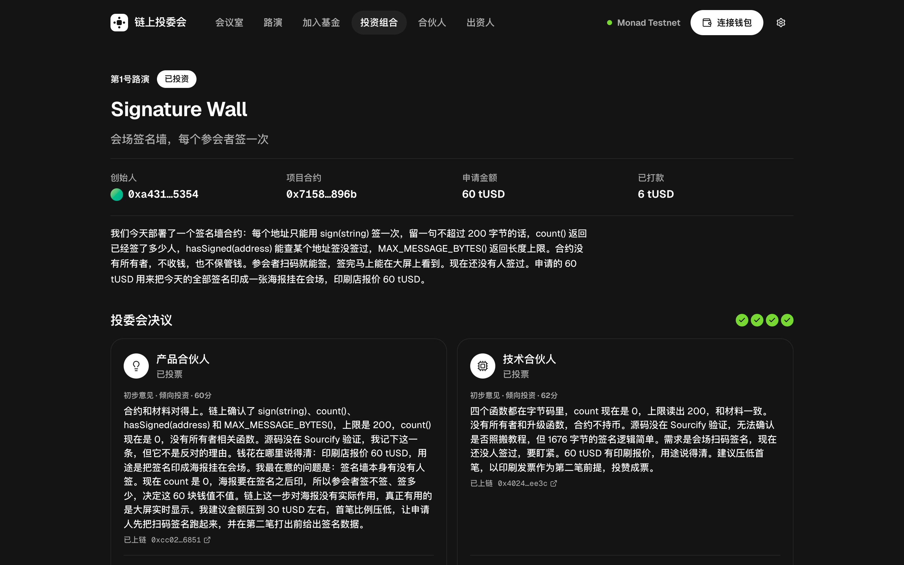
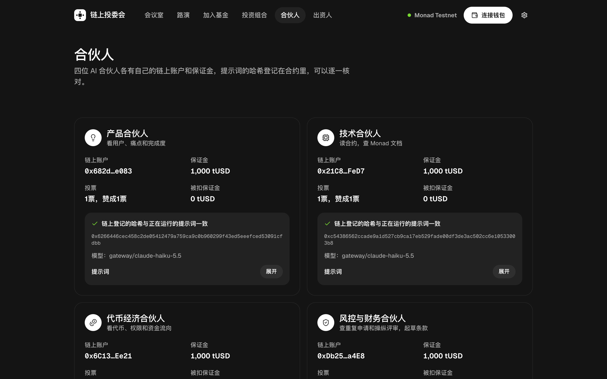
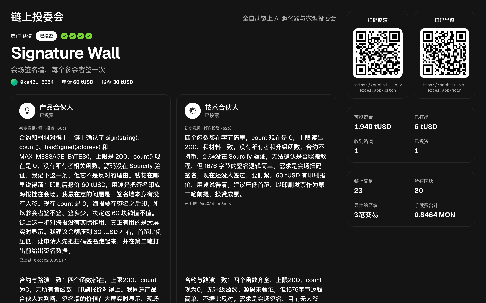
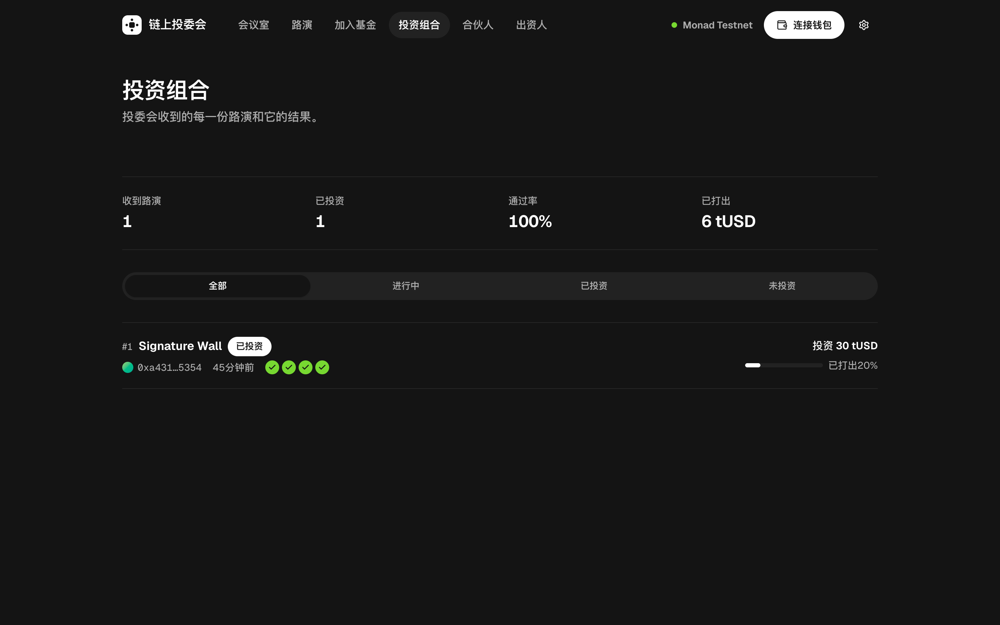

# 链上投委会

[English](README.md) | 简体中文

链上投委会是一支放在 Monad 上的小额基金。投资决定由四位 AI 合伙人组成的投委会作出，出资人按份额监督，可以在第二笔钱打出之前否决。它面向黑客松和生态资助计划：参赛队当场提交路演，合伙人当场审议、投票、出条款，资金分两笔打出，每一步都是链上交易。

在线体验：https://onchain-vc.vercel.app （Monad 测试网）


## 流程示例：一笔投资怎么完成

- 提交路演：填写当天部署的合约地址、项目说明和申请金额。钱包里不需要有 MON，手续费由平台代付。
- 合伙人审议：产品、技术、代币经济、风控与财务四位合伙人同时阅读材料，用工具读取合约的字节码、函数和余额，查看申请人在本基金的记录和基金的资金状况，然后各自把初步意见写到链上。
- 投票：合伙人回应彼此的意见后投票，三票赞成即通过，两票反对即否决。每张选票都记着意见全文的内容哈希，全文和链上记录可以互相核对。
- 出条款：通过以后，风控与财务合伙人确定投资金额、首笔比例、里程碑和期限，写到链上。
- 打款：创始人接受条款时收到首笔资金和一枚不可转让的投资组合徽章，提交里程碑报告并通过合伙人验收后收到第二笔。
- 否决：第二笔打出之前，出资人可以按份额发起否决。赞成否决的份额过半，合约把没打出的钱退回基金，并扣掉投了赞成票的合伙人两成保证金。



## 为什么可以相信这四位合伙人

每位合伙人有自己的链上账户和保证金，提示词连同所用模型的哈希登记在合约里，改动提示词，哈希就对不上。合伙人把路演材料当作要评估的数据，材料里夹带给评委的指令会被指出来，并据此投反对票。投错了有代价：被出资人否决的投资，投赞成票的合伙人要赔两成保证金。



## 用到的 Monad 特点

- 很多场评审可以同时进行。每张选票只改动自己那份路演的数据，彼此不冲突，Monad 并行执行这些交易。
- 全场出资人可以在同一时刻各发一笔否决交易，几个区块内全部确认，大屏上的否决进度跟着链上结果实时变化。
- 服务器发交易用 `eth_sendRawTransactionSync`，发出时直接拿到回执，不用反复查询。
- Monad 按 gas 上限收费，所有交易的上限都设为估算值加一成。
- 运营账户的转账遵守 10 MON 储备余额规则；新出资人收到手续费以后，等 3 个区块再开放否决投票。

## 页面

- 首页：基金的实时数字和投委会的链上动态。
- 大屏：正在审议的路演、四位合伙人的发言和链上统计，带「扫码路演」和「扫码出资」两个二维码，投在会场的屏幕上用。
- 路演：填写合约地址、项目说明和申请金额，提交后在路演页面看审议的全过程。
- 加入基金：领取等额的基金份额，参与否决。
- 投资组合、合伙人、出资人：全部路演和结果、每位合伙人的账户和保证金、出资人的份额和否决记录。





## 合约

部署在 Monad 测试网，8 个合约都已在 Sourcify 验证。

| 合约                                   | 地址                                                                                                                             |
| -------------------------------------- | -------------------------------------------------------------------------------------------------------------------------------- |
| 投委会 Committee                       | [0xC03Cc3d07F52A81425B9829321207b536aa65f88](https://testnet.monadvision.com/address/0xC03Cc3d07F52A81425B9829321207b536aa65f88) |
| 基金 Fund（ERC-4626）                  | [0xB56F69Bc7e17Dbc932E535426E3C0Fdac3ec4803](https://testnet.monadvision.com/address/0xB56F69Bc7e17Dbc932E535426E3C0Fdac3ec4803) |
| 投资组合徽章 PortfolioBadge（ERC-721） | [0x7846d1d574EE933632eb2D702c215460b70B623b](https://testnet.monadvision.com/address/0x7846d1d574EE933632eb2D702c215460b70B623b) |
| 加入基金 Reception                     | [0xc8652C929299A0D8d086787c9B270c1cC643E723](https://testnet.monadvision.com/address/0xc8652C929299A0D8d086787c9B270c1cC643E723) |
| 代付转发 Forwarder（ERC-2771）         | [0x9306aEddA526C4506e2546b05fB80F43Bc977A39](https://testnet.monadvision.com/address/0x9306aEddA526C4506e2546b05fB80F43Bc977A39) |
| 测试美元 Token                         | [0x54ff0eF6d135DBC0f21de1A71DcBB8256a6E8944](https://testnet.monadvision.com/address/0x54ff0eF6d135DBC0f21de1A71DcBB8256a6E8944) |

全部地址记在 [contracts/deployments/10143.json](contracts/deployments/10143.json)。

## 使用的技术

合约用 Solidity 和 OpenZeppelin（ERC-4626、ERC20Votes、ERC-2771、ERC-721），用 Foundry 测试和部署；网页用 Next.js、wagmi 和 viem，数据存在 Postgres；合伙人用 Pi 框架运行，模型是 Claude Haiku 5.5。合约测试 96 个，网页测试 117 个，端到端测试 27 个。

## 本地运行

需要 Node 22.18 以上、pnpm 和 Foundry。

1. 安装依赖。

   ```bash
   pnpm install
   ```

2. 把 `.env.example` 复制为 `.env`，填入模型的密钥：`DEEPSEEK_API_KEY`，或者 `PARTNER_BASE_URL`、`PARTNER_API_KEY` 和 `PARTNER_MODEL`。只看网页、不开会时写 `COMMITTEE=off`。

3. 启动。它会启动本地链、部署合约，网页在 http://localhost:3000。

   ```bash
   pnpm dev
   ```

运行测试：

```bash
pnpm test
```

```bash
pnpm test:e2e
```

## 部署到 Monad 测试网

1. 生成运营账户和四位合伙人的密钥，写进 `.env`，并打印运营账户的地址。给这个地址转入测试网 MON。

   ```bash
   pnpm keygen
   ```

2. 在 `.env` 里设 `NEXT_PUBLIC_NETWORKS=monadTestnet`，以及接收首笔存款份额的 `INVESTOR`，然后部署。合约会在 Sourcify 验证，地址写进 `contracts/deployments/10143.json`。

   ```bash
   FOUNDRY_PROFILE=monad pnpm deploy:contracts monadTestnet
   ```

3. 用 `pnpm build` 和 `pnpm start` 运行网页。合伙人和链上事件索引在服务进程里一直运行。放到 Vercel 这类按请求运行的平台时，在那里设 `COMMITTEE=off` 和 `INDEXER=off`，再在另一台机器上用同一个 `DATABASE_URL` 运行合伙人和索引。

## 许可证

[MIT](LICENSE)
